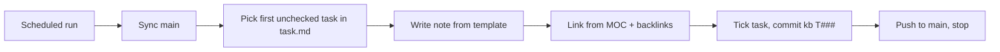

# Knowledge Hub

A personal Obsidian vault of senior-level notes on full-stack and AI engineering. A scheduled Claude agent grows it by **one task per run**, following a fixed rulebook and a task queue that are both in the repo.

> [!note] Snapshot — 2026-10-16
> 150 notes across 13 domains: 68 overviews, 49 deep dives, 20 references and 14 MOCs. 131 tasks completed.

## Domains

| # | Domain | Scope |
|---|---|---|
| 01 | Languages | JavaScript, TypeScript, Python, Go, Rust, Java, Kotlin, Swift, Dart, PHP |
| 02 | Frontend | React, Next.js, Astro, WebGL, Tailwind, browser fundamentals |
| 03 | Mobile | Flutter, React Native, native iOS/Android |
| 04 | Backend | Node.js, Spring Boot, Supabase, testing |
| 05 | Databases | PostgreSQL, MySQL, Redis, NoSQL, vector DBs |
| 06 | Messaging & Streaming | Kafka, queues, pub/sub |
| 07 | DevOps & Infrastructure | Docker, Kubernetes, Coolify, Traefik, Nginx, Cloudflare, Linux, Git, CI-CD |
| 08 | Automation | n8n, Windmill, workflow engines |
| 09 | Networking & APIs | HTTP & HTTPS, REST, WebSocket, GraphQL, gRPC |
| 10 | Security | Network security, auth (JWT, OAuth 2.0 & OIDC), OWASP |
| 11 | CS Fundamentals | Big O, data structures, algorithms, system design, patterns |
| 12 | Web3 | Blockchain, Ethereum/EVM, Solidity, wallets |
| 13 | AI Engineering | LLMs, prompting, RAG, agents, MCP, LangChain & LangGraph, evals, fine-tuning |

## Note Types

| Type | File name | Content |
|---|---|---|
| Overview | `<Topic>.md` | TL;DR, core concepts, architecture, use cases, pros & cons, alternatives, versions & breaking changes, critical issues |
| Deep dive | `<Topic> - <Subtopic>.md` | One mechanism in depth, linked from the overview |
| Reference | `<Topic> - <Subtopic>.md` | Cheat sheets, interview question banks |
| MOC | `<Domain> MOC.md` | Map of Content: the hub for each domain |

Every note has YAML frontmatter (`type`, `domain`, `status`, `version_checked`, `parent`, `related`) and hierarchical tags (`domain/*`, `type/*`, `topic/*`). Each note checks the latest stable version with a web search and records the month it was verified. CVEs, license changes and data-loss risks go in `[!danger]` callouts.

## Layout

```text
00 - Home.md              entry point, links every domain MOC
CLAUDE.md                 vault rules (binding for the agent and manual edits)
task.md                   task queue, the loop's only state
_templates/               canonical note structures
_attachments/             images only
NN - <Domain>/
  <Domain> MOC.md
  <Topic>/
    <Topic>.md
    <Topic> - <Subtopic>.md
```

## How It Grows



- **Task types:** `overview`, `deep-dive`, `reference`, `moc`, `maint` (link audit and stale-version refresh), `replenish` (queues the next 12 tasks).
- **Budget per run:** 1 task, ≤ 3 web searches, ≤ 5 files changed. Notes run 100–350 lines.
- **Blocked tasks** get a `⚠️` marker and are skipped until reviewed by hand.
- **Commits** follow `kb(T###): <type> <Topic>`, so `git log` doubles as the changelog.

The full protocol is in [`CLAUDE.md`](CLAUDE.md) §8–§9.

## Usage

1. Clone the repo and open the folder as a vault in [Obsidian](https://obsidian.md).
2. Start at `00 - Home.md`, or use graph view: MOCs are the hubs and grey nodes are planned notes.
3. To steer the agent, edit `task.md`: insert, reorder or delete `- [ ] T###` lines.

Only shared Obsidian config (`app.json`, `appearance.json`, `core-plugins.json`, `graph.json`, `templates.json`) is tracked. Plugins and per-device state are not. `.gitignore` is a whitelist, so anything outside the vault layout is ignored.

## Disclaimer

These are personal study notes, written mostly by an AI agent. Version info is current as of each note's `version_checked` date. Check vendor docs before relying on it in production.
